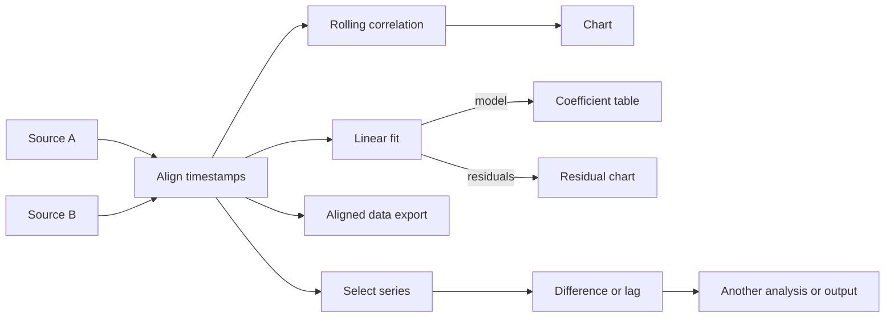

# Architecture and reuse decisions

Streamweave v0.2 is a general numerical workbench. Its canvas describes the calculation itself: multiple independent sources, repeated module types, branches, and several outputs. The v0.1 pressure pipeline remains an optional legacy API.

## Boundaries

1. **Data contracts:** a table contains typed scalar columns; a series contains timestamped values, units, quality states, and optional availability times; an aligned frame contains several numeric columns on one time axis. Dataset IDs are distinct from module IDs, so several source modules can select different columns of the same dataset.
2. **Module registry:** each definition declares input/output ports, compatible data kinds, input cardinality, defaults, and descriptive metadata. The inspector and module search use that registry. Mathematical kernels remain independent of the UI.
3. **Graph executor:** validates IDs, ports, cycles, sizes, and parameters, then evaluates a topological order. It uses actual incoming edges and computes a shared parent once. Errors block only descendants; disconnected valid branches still execute. Positions do not affect numerical results.
4. **Workbench:** React Flow provides editing, named handles, duplication, dragging, and deletion. A worker performs calculation. Changing data or parameters terminates the previous worker; moving nodes does not recompute. Outputs expose values through paginated tables, individual-scale charts, and downloads.
5. **Persistence:** version 2 project JSON embeds graph and datasets. Browser Save uses a separate v2 storage key and leaves v1 storage alone. Results JSON embeds the current project and engine version; CSV is a flat inspection/export format, not the complete project format.

## Example with reusable branches

The built-in study implements the first four outputs. The last branch illustrates additional composition available through module search. To compare multiple window lengths, duplicate a correlation module, connect it to the same aligned frame, configure its window, and connect both outputs to a chart.

## Editor ownership

The application composes explicit interfaces; project state does not contain browser controls or canvas measurements.

| Module                                                | Owns                                                                        |
| ----------------------------------------------------- | --------------------------------------------------------------------------- |
| `App.tsx`                                             | Project lifecycle, notices, selection, and composition of canvas/results    |
| `projectFiles.ts`                                     | File parsing, bounded imports, browser persistence, portable downloads      |
| `projectHistory.ts` / `useProjectHistory.ts`          | Immutable history, 50-entry bounds, undo/redo and drag checkpoints          |
| `useGraphRun.ts`                                      | Worker lifecycle, calculation dependencies, cancellation, errors            |
| `editorModel.ts`                                      | Pure insert/delete operations, compatible ports, source binding             |
| `useGraphEditing.ts`                                  | React Flow changes, transient measurements/edge selection, parameter edits  |
| `useCanvasInsertion.ts`                               | Pointer coordinates, search, placement, wire continuation, keyboard actions |
| `CanvasWorkspace.tsx` / `CanvasPanels.tsx`            | Canvas composition and editor controls                                      |
| `ModuleNode.tsx` / `NodePicker.tsx` / `Inspector.tsx` | Node display, searchable module choice, parameter forms                     |
| `ResultsPanel.tsx` / `DataView.tsx`                   | Output/inspection states, charts, tables, download controls                 |

Import and insertion are distinct actions. A dataset click previews data; creation requires a drag or explicit placement. Graph changes use immutable operations and do not perform I/O inside React state updaters. Connected insertion and selection deletion each commit one history entry. Measured node bounds are retained separately so recomputation cannot erase visible wires. Core tests validate numerical behavior; editor tests validate edit transactions and import boundaries. Formatting is enforced by `npm run check` and CI.

## Reuse after reviewing earlier assets

The owner's earlier analytical lab was examined for data adapters, factor factories, time-series routines, artifacts, and correlation workflows. The useful contributions are architectural patterns; the general executor and numerical kernels here are new TypeScript implementations with explicit tests.

| Earlier component                          | Useful idea                                            | Decision in this workbench                                                         |
| ------------------------------------------ | ------------------------------------------------------ | ---------------------------------------------------------------------------------- |
| Data-source adapter abstraction            | Normalize independent sources behind a common contract | Generic timestamped datasets; file adapters first                                  |
| Factor registry and configurable factories | Reusable modules with declared configuration           | Typed registry plus unrestricted acyclic composition                               |
| Versioned artifacts                        | Save enough information to reproduce a result          | Embedded datasets, graph, parameters, units, version                               |
| Time-series statistics                     | Small reusable numerical kernels                       | Mean, sample deviation, EMA, Pearson correlation, and OLS with analytical fixtures |
| Correlation orchestration                  | Compare separate sources                               | Join timestamps explicitly; do not pair trailing array positions                   |
| Visual strategy canvas                     | Configure and compose calculations                     | Repeated instances, multiple inputs/outputs, independent branches                  |
| Signed-flow tracker                        | Normalized signed-weight pressure                      | Optional module using the already-tested legacy accumulator                        |

Some legacy routines and domain-specific services were simplified or tightly coupled. They were not copied as general-purpose scientific implementations. GPU rendering, service orchestration, identity/billing, external execution, and unvalidated predictive ensembles are outside this release. Private inventory notes record source paths and revisions locally.

## Extension boundary

A future module needs port contracts, parameter validation, a deterministic kernel, inspector controls, and numerical tests. A future data connector owns retrieval, units, timestamps, release/revision semantics, and normalization; the core should still receive explicit data. There is no arbitrary code evaluation or network request inside a graph.

The workbench is bounded batch calculation, not a live streaming scheduler. The old incremental pressure API remains independently usable. Rolling kernels currently scan each bounded trailing window, O(rows × window); they make no low-latency claim. Worker cancellation prevents stale results from replacing newer edits.
