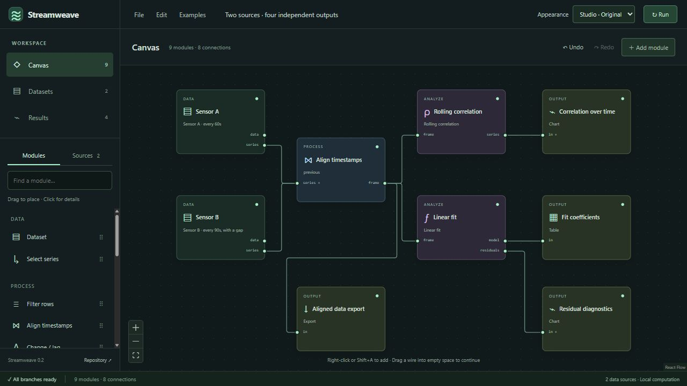

# Appearance

Streamweave has two appearances, selected from **Appearance** in the top bar. The selector stays available in Canvas, Datasets, and Results.

| Appearance            | Purpose                                                                                                                 |
| --------------------- | ----------------------------------------------------------------------------------------------------------------------- |
| **Classic · Retro**   | Default. A charcoal header, light workspace, blue links, compact controls, square panels, and restrained status colors. |
| **Studio · Original** | The original dark green workspace, with its existing module colors and controls.                                        |

Classic takes visual inspiration from the [classic Jenkins interface](https://www.jenkins.io/blog/2014/08/11/user-interface-refresh/). It uses Streamweave's own branding and components; no Jenkins artwork is included.

## Remembering your choice

The choice applies immediately and is remembered in this browser for the same site address, including its port. A new browser or address starts with Classic. Unknown saved values also fall back to Classic.

Appearance is a personal browser preference. It is separate from the workspace, downloaded project, numerical results, and undo history. Switching appearance keeps your graph, selected view, and canvas position.

If browser storage is blocked or full, switching still works for the current session. A message beside the selector explains that the preference could not be saved. Reload uses whichever preference can be read, or Classic when none is available.

## Extending the presentation

`apps/workbench/src/features/appearance/` owns the theme catalogue, provider, selector, and Classic styles. `platform/appearanceStorage.ts` isolates browser storage and document appearance changes. The shared canvas and chart use theme values for their color mode, grid, and accent.

Both appearances render the same component tree and use the same document and execution services. Add future presentation changes here, keeping numerical behavior and project formats independent. Do not fork the workspace into a separate implementation per theme. See [Extension ownership](extension-guide.md) for the other boundaries.
