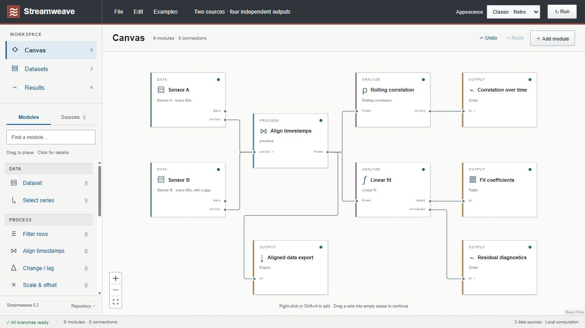

# Streamweave documentation

Streamweave is a local numerical workbench for composing calculations across independent timestamped datasets. Import files, connect typed modules on a canvas, and inspect reproducible results. It is an early foundation for a lightweight visual calculator; it does not implement a MATLAB-compatible language.

The current release is **v0.2**. Calculations run locally in a browser worker. No account, external data connection, or remote calculation service is required to use the workbench.

## Start with a task

| I want to…                                               | Read                                                                      |
| -------------------------------------------------------- | ------------------------------------------------------------------------- |
| Run the application and complete a first study           | [Getting started](getting-started.md)                                     |
| Add, configure, connect, and reuse modules               | [Canvas guide](canvas-guide.md)                                           |
| Import data and understand timestamps and missing values | [Data and time](data-and-time.md)                                         |
| Choose a calculation and its parameters                  | [Module reference](module-reference.md)                                   |
| Inspect, save, and reproduce a result                    | [Results and projects](results-and-projects.md)                           |
| Understand the formulas and their assumptions            | [Numerical contract](../analytics.md)                                     |
| Understand implementation boundaries                     | [Architecture](../architecture.md)                                        |
| Find where to implement a new capability                 | [Extension ownership](extension-guide.md)                                 |
| Choose a native file or interchange format               | [File formats and archiving](file-formats.md)                             |
| Change the code or publish these docs                    | [Contributor guide](contributing.md)                                      |
| Assess reliability and remaining gaps                    | [Code quality](../code-quality.md), [validation record](../validation.md) |
| Diagnose an import or calculation error                  | [Troubleshooting](troubleshooting.md)                                     |
| Understand current scope and possible next steps         | [Scope and roadmap](scope-and-roadmap.md)                                 |

## Workspace model

**Datasets** are reusable source assets. **Modules** perform configured operations. **Connections** carry typed values between ports. **Outputs** expose results without changing the calculation. One dataset can supply several source modules; one module can feed several branches. There is no prescribed path or mandatory composite index.

The persistent sidebar switches between Canvas, Datasets, and Results. File, Edit, and Examples stay available in the top menu. Only the selected workspace view is shown, and returning to Canvas preserves its position.

**Classic · Retro** is the default light appearance. The original dark **Studio** appearance remains available from the top bar. See [Appearance](appearance.md) for switching, persistence, and implementation ownership.

Documentation sources live alongside the code in the private [repository](https://gitlab.com/Deamenophobia/streamweave). The wiki is published from those sources; update the repository first so changes remain reviewable and versioned.
