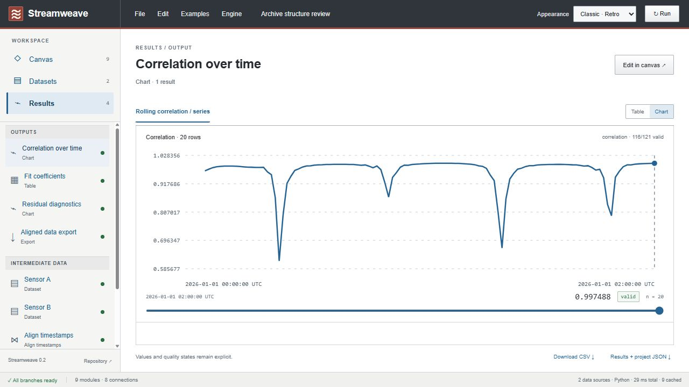

# Local Python engine

Streamweave offers two calculation engines behind the same canvas. **Browser** runs the TypeScript core in a Web Worker and remains the default. **Python** runs an optional service on your computer using NumPy and SciPy. Both implement the existing 15 modules and accept the same version 2 project files. Python adds a numerical-library extension point; it does not add arbitrary scripts or a MATLAB language.

## Install and use

From the repository root, with Node.js 22.12+ and Python 3.12 installed:

```sh
npm ci
npm run engine:setup
npm run engine:start
```

Setup creates `.local/engine-venv` and installs pinned dependencies from `services/engine/requirements.txt` with transitive constraints in `requirements.lock`. Set `STREAMWEAVE_PYTHON` to a Python executable if it is not on PATH. Setup uses that interpreter to create the environment; start/check use the override directly when supplied, so clear it after setup to use the created environment.

In another terminal, run `npm run dev` and open **http://127.0.0.1:5187**. Choose **Engine → Python · local service**. The service listens on **127.0.0.1:5191**; workbench origins on localhost or 127.0.0.1 at ports 5187 and 5188 are allowed. Production preview uses 5188. Stop the service with Ctrl+C.

Engine choice lasts for the current page session. Reload starts with Browser. Changing engines reruns the current graph without changing the document. A missing or incompatible Python service produces an explicit error; choose Browser to recover. There is no silent fallback that would obscure which engine produced a result.



The status bar shows the selected engine, progress between nodes, total request time, and cache hits. Python total time includes upload when needed, polling, transfer, and response decoding; exported engine metrics retain computation time separately. **Cancel** stops accepting the current result and requests cancellation. Browser cancellation terminates its worker. Python checks cancellation between nodes and numerical chunks; an in-progress native library call must return first. Rapid edits replace obsolete runs, and an older response cannot overwrite the latest result.

## Contracts and numerical behavior

The TypeScript registry remains the source for module ports, parameter fields, defaults, and bounds. `npm run contracts:generate` exports `protocol/modules.json`; CI rejects a stale export. Both sides compare its SHA-256 digest and protocol version before calculating.

Python validates datasets once on upload with Pydantic and retains the normalized objects in a bounded session. Subsequent jobs validate only their graph and reference the uploaded bundle. Graph port compatibility is checked before evaluation; trusted built-in evaluators use typed values without rescanning rows or repeating output-shape checks inside the scheduler. Numerical domain checks and the finite-JSON output boundary remain. Numerical modules preserve nulls, quality states, units, timestamp alignment, observation availability, sample standard deviation, and in-sample regression metadata. Rolling calculations use bounded incremental moments and monotonic queues, with periodic recentering and explicit constant-window handling; linear fit uses centered and scaled SciPy least squares. Both use binary64 floating point, so tiny rounding differences are expected. Changing language does not automatically increase precision or validate a scientific model.

Cross-engine fixtures compare calculated values with tolerance 1e-9; timestamps, availability times, counts, structure, and quality states match exactly. Independent analytical fixtures also test known answers. This is evidence for the covered cases, not proof that either implementation is universally correct.

Project JSON remains version 2 and contains no engine connection or machine path. Results JSON adds engine ID, engine version, protocol version, contract digest, and numerical-library versions when available. Reopening the project works with either engine; bit-for-bit equality across numerical-library versions is not promised.

## Ownership and extensions

| Responsibility                               | Location                                                                                                         |
| -------------------------------------------- | ---------------------------------------------------------------------------------------------------------------- |
| Engine interface, selection, cancellation    | `apps/workbench/src/execution/contracts.ts`, `useGraphRun.ts`                                                    |
| Browser worker adapter                       | `apps/workbench/src/execution/browserEngine.ts`                                                                  |
| Local HTTP adapter and response validation   | `apps/workbench/src/execution/pythonEngine.ts`, `protocol.ts`                                                    |
| Generated shared module contract             | `protocol/modules.json`, generated by `scripts/export-module-contracts.ts`                                       |
| HTTP boundary and bounded job lifecycle      | `services/engine/streamweave_engine/server.py`, `jobs.py`                                                        |
| Project preparation, graph scheduling, cache | `models.py`, `graph.py`, `executor.py`, `cache.py` in the engine package                                         |
| Numerical implementations                    | `rolling.py`, `statistics.py`, `transforms.py`, `alignment.py`, `tables.py`, `pressure.py` in the engine package |
| Build-time evaluator registration            | `services/engine/streamweave_engine/registry.py`                                                                 |

Internal series, frames, nodes, results, and job states have explicit types in `contracts.py`; Mypy checks all engine source files in CI. `sessions.py` owns validated datasets and node caches, while `transport.py` projects compact HTTP results. The frontend keeps one previous decoded result and reuses its unchanged output objects without scanning their rows again.

To add a calculation, define its public contract and browser implementation in the core registry, generate the manifest, then add its Python evaluator to the focused numerical module and register it. Add an independent expected-value test and a cross-engine fixture. Do not branch on module type in the scheduler, HTTP service, or inspector. The Python dependency test rejects local cycles and numerical dependencies on service/job orchestration. Add tests for observable behavior, numerical edge cases, and extension contracts; do not duplicate boundary-validation cases at every internal layer. See [Extension ownership](extension-guide.md).

## Resource and trust boundaries

The service receives dataset JSON and graph JSON and returns calculation results. It accepts no Python code, file paths, remote source URLs, or credentials. It binds to loopback and checks Host, browser Origin, protocol, and per-page session IDs. These checks do not make it a hosted multi-user service or protect it from another process running as your local user.

Existing input limits remain: 12 datasets, 50,000 total rows, 20,000 rows per dataset, 40 columns per dataset, 50 modules, 120 connections, 1,000 observations per rolling window, and a 15 MB dataset-upload request. Graph job submissions are limited to 1 MB. Python results are limited to 30 MB of encoded node outputs.

The service permits two active jobs and four retained job slots. Completed jobs expire 60 seconds after completion; a cleanup thread runs every five seconds even when no further requests arrive. Idle sessions expire after five minutes. The client releases each consumed or cancelled job. A job has a cooperative 120-second deadline, with a 125-second client deadline. There is no disk persistence. Each of two sessions holds one validated dataset bundle and an LRU node cache. A cache has both a 16 MB encoded-output budget and a 64 MB conservative Python-object budget. Shared objects are counted once within an entry, and may be counted again across entries; this can evict early. These budgets are not a total process-RAM limit: active jobs, retained results, source bundles, temporary arrays, and serialization also consume memory. Active jobs keep their dataset bundle when a new upload replaces the session bundle.

Cache keys include node parameters, input data, upstream dependencies, contract digest, engine version, and numerical-library versions. Moving nodes or renaming the project does not recalculate. A correlation-window edit invalidates that node and its descendants while retaining unrelated branches. Stop the service to discard all cached data.

## Local protocol 2

Update the workbench and Python service together. Engine 0.2.0 uses `/v2` endpoints and protocol header `2`; portable project JSON is still version 2. The earlier HTTP protocol is not supported by this service version.

1. `GET /v2/capabilities` checks the contract digest and protocol.
2. `PUT /v2/datasets/{bundleId}` uploads and validates source datasets once per bundle. The UI uses an opaque ID tied to its immutable dataset array, with no per-run dataset hashing in the browser.
3. `POST /v2/jobs` sends the graph, bundle ID, and previous node-result keys. An expired bundle returns `datasets_missing`; the UI uploads again and retries once.
4. `GET /v2/jobs/{jobId}` returns only status/progress. `GET /v2/jobs/{jobId}/result` returns completed output changes. Unchanged nodes reference the client's previous keys; source tables reference the already uploaded dataset. Intermediate results and exports remain available in the UI.
5. `DELETE /v2/jobs/{jobId}` cancels or releases the job.

Errors carry stable codes such as `invalid_request`, `invalid_project`, `datasets_missing`, `capacity`, `timeout`, and `job_missing`. Unexpected internal failures expose a generic message; a local diagnostic logs the job ID and exception class without dataset cells. There is no remote telemetry.

## Verification and performance

```sh
npm run check
npm run engine:check
# With engine:start running:
npm run engine:benchmark
```

The benchmark writes `.local/engine-benchmark.json`. It measures the existing TypeScript core under Node, a warm Python engine, and complete local HTTP requests including JSON and 120 ms polling. It excludes UI rendering and interpreter startup. Fresh HTTP measurements include dataset validation; cached runs reuse validated inputs and previously decoded outputs. Set `STREAMWEAVE_ENGINE_PID` to the actual service process ID to include a sampled service-RSS measurement; the probe runs only during the benchmark. See the [validation record](../validation.md) for measured results and limitations.

Small calculations often favor Browser because Python incurs validation and transport costs. Vectorized calculations and cached branches can help larger or repeated studies, and the rolling mean, sample deviation, extrema, count, and correlation kernels now scale linearly with row count while retaining bounded window state. Neither engine is an unlimited data-processing service.
