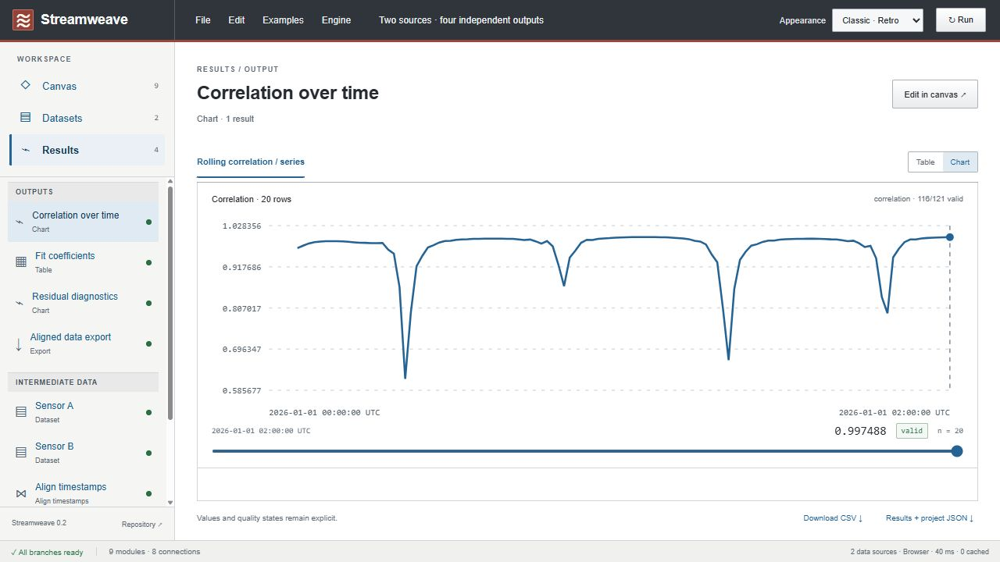

# Results and projects

## Inspect one result

The Results sidebar separates output modules from intermediate data. Select a module, then a result port or incoming connection. Switch between Table and Chart when the value supports both; arbitrary tables such as model coefficients do not have a time-series chart.



Tables paginate through every row in groups of 25. Charts show units, valid counts, gaps, UTC timestamps, and a time cursor. Frame columns use independent scales. A null value breaks the line; it is never plotted as zero. Residuals show their availability and in-sample interpretation.

**Edit in canvas** selects and centers the module. The inspector's **Open module results** brings you back to its data. Changing parameters recomputes the graph automatically; computation state prevents exporting an old result while a new calculation is running.

## Choose a save or export format

For the design rationale and future Excel/YAML options, see [File formats and archiving](file-formats.md). JSON remains the implemented native workspace format.

| Action                  | Contains                                                                          | Restore/edit later?                                                                          |
| ----------------------- | --------------------------------------------------------------------------------- | -------------------------------------------------------------------------------------------- |
| File → Save in browser  | Current graph and embedded datasets in this browser's local storage               | Reloads in the same browser profile and origin                                               |
| File → Download project | Version 2 project JSON: graph, parameters, positions, embedded datasets           | Yes, via File → Open project                                                                 |
| Dataset → Download CSV  | Selected source table                                                             | Import as a new dataset if it satisfies import rules                                         |
| Result → Download CSV   | Selected value, with units/status/availability where represented by its data type | A flat result, not the original workflow                                                     |
| Results + project JSON  | Module ID, results, full project, format/version, engine version                  | Use its embedded `project` for programmatic reproduction; this wrapper is not a project file |

Browser Save is explicit, not autosave. Local storage can be unavailable or exceed its quota, and it is tied to the exact origin (including port). Keep a portable download before clearing browser data or switching devices. Starting a new workspace or loading an example replaces the in-memory document without saving it first.

Project files embed source data. Treat a downloaded project or results JSON as containing the original inputs when deciding where to share it. The application itself has no data-upload or telemetry service.

## Reproduce using the core

Build the package with `npm run build`, then run an ES module from the repository:

```js
import { readFileSync } from "node:fs";
import { executeWorkbench, parseProject } from "@streamweave/core";

const project = parseProject(readFileSync("streamweave.project.json", "utf8"));
const run = executeWorkbench(project.graph, project.datasets);
console.log(run.nodes.fit?.outputs.model);
```

For a results export, parse its `project` property through `parseProject(JSON.stringify(exported.project))` before execution. Store the repository commit with research artifacts if exact implementation reproducibility matters: `engineVersion` identifies the release, not each development commit.

The v2 interface opens v2 project files. It does not migrate v1 pipeline files. Undo history, selection, canvas viewport, and measured node bounds are not included in portable files. See [Architecture](../architecture.md) for persistence and worker ownership.
